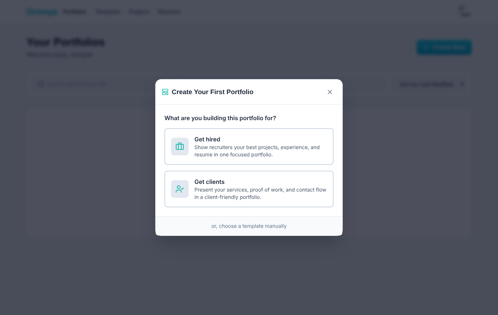
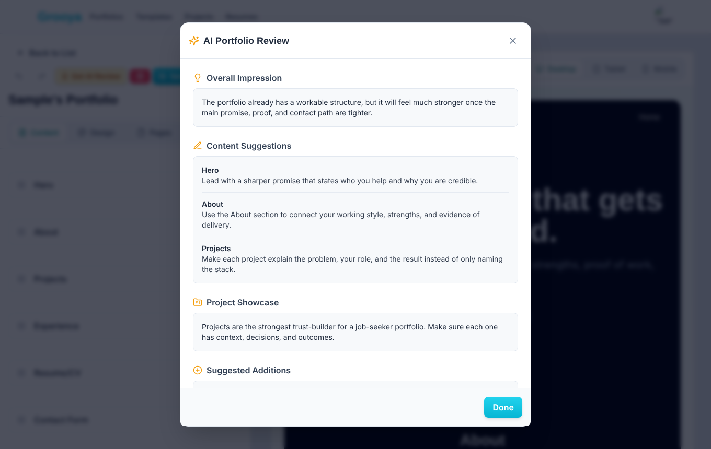

# Grooya

A portfolio and resume builder for job seekers and freelancers. You pick a goal (get hired or get clients), Grooya sets up a portfolio with the right sections, you edit it with a live preview, and an AI review tells you what to tighten before you publish.


## What it does

- **Goal-first setup.** A new portfolio starts from the goal: "Get hired" leads with projects, experience and resume; "Get clients" leads with services, proof of work and a contact flow.
- **Section editor with live preview.** Drag sections to reorder them, edit content with a rich-text editor, and check the layout at desktop, tablet and mobile widths. Undo and redo are built in.
- **Templates and design control.** Six starting templates, with design settings for colours, fonts and layout.
- **AI help.** Suggestions for the hero, about, project and experience sections, a full portfolio review, and resumes generated from the portfolio or tailored to a job description.
- **Resumes.** Keep several resume versions linked to the portfolio and print them.
- **Public pages.** Each published portfolio gets a public URL. Contact form submissions are stored as leads.
- **Plans and limits.** Free, Starter and Pro plans, with AI usage quotas and feature flags per plan.
- **Arabic and English**, including a right-to-left layout.

| Start from a goal | AI portfolio review |
|---|---|
|  |  |

## How it is built

| Layer | Stack |
|---|---|
| Front end | React 19, TypeScript, Vite, React Router (hash routing), Framer Motion, dnd-kit, Tiptap |
| Back end | Django 6 and Django REST Framework, session authentication with CSRF protection |
| Database | SQLite for local development, PostgreSQL through environment variables |
| AI | Gemini, called only from the back end. Without a key, a built-in heuristic provider answers, so every AI feature still works locally |

The back end is split into one Django app per domain: `accounts`, `portfolios`, `resumes`, `ai`, `leads`, `billing`, `analytics`, `feature_flags`, `domains` and `platform_admin`. Architecture notes are in `docs/architecture/`, and product planning (PRD, roadmap, rollout, monetisation) is in `planning/`.

## Run it locally

You need Node 20+ and Python 3.12+ (Django 6).

**Back end** (port 8000)

```bash
cd backend
python -m venv .venv && source .venv/bin/activate
pip install -r requirements.txt
python manage.py migrate
python manage.py runserver 8000
```

**Front end** (port 5173, proxies `/api` to the back end)

```bash
npm install
npm run dev
```

Open http://localhost:5173, choose **Get Started**, register, and create a portfolio.

### Settings

All settings are environment variables. None is required for local development.

| Variable | Purpose | Default |
|---|---|---|
| `GEMINI_API_KEY` | Turns on the Gemini provider for AI features | unset (heuristic provider) |
| `GEMINI_MODEL` | Gemini model name | `gemini-2.5-flash` |
| `DJANGO_SECRET_KEY` | Django secret key. Set it outside development | development value |
| `DJANGO_DEBUG` | Debug mode | `true` |
| `DJANGO_ALLOWED_HOSTS` | Comma-separated hosts | `localhost,127.0.0.1,testserver` |
| `DJANGO_CSRF_TRUSTED_ORIGINS` | Origins allowed to send writes. Add your front-end origin if it is not on port 5173 | `http://localhost:5173,http://127.0.0.1:5173` |
| `POSTGRES_ENGINE`, `POSTGRES_DB`, `POSTGRES_USER`, `POSTGRES_PASSWORD`, `POSTGRES_HOST`, `POSTGRES_PORT` | Database | SQLite in `backend/db.sqlite3` |
| `VITE_BACKEND_URL` | Where the dev server proxies `/api` | `http://localhost:8000` |

## Known gaps

- Styling uses the Tailwind Play CDN with an inline config in `index.html`. That is fine for development, but a production build should compile Tailwind instead.
- `npx tsc --noEmit` reports type errors that the Vite build does not check. They are not fixed yet.
- The Django apps have no tests yet.
- `celery`, `redis` and `stripe` are in `requirements.txt` for planned work. Local development does not need them running.
